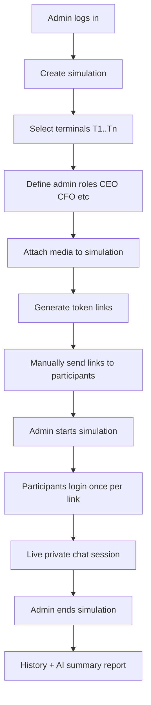
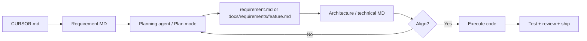

# CURSOR.md

Repository-level instructions for **Cursor**, Claude Code, and other AI assistants working on **London School Chat (Paton Messaging Service / LBS Simulation Platform)**.

This file is the **master project context**. Read it before any feature work.  
Structure follows `claude_updated.md`, with **business context first**, then **delivery workflow**, then **technical rules**.

---

# PART A — BUSINESS CONTEXT

## 1. Project Overview

London School Chat is a **business simulation messaging platform**. An admin creates a simulation, configures participant terminals and role-play identities (CEO, CFO, etc.), attaches media resources, and runs a live chat session. The admin interacts with participants to assess their **mentality, attitude, and caliber**. Participants may be **students** or **employees from different firms**. They join via one-time token links; the admin communicates with each terminal/role in private threads. After the session, chat history and AI summary reports can be exported.

| Field | Detail |
|-------|--------|
| **Name** | London School Chat / Paton Messaging Service (LBS Simulation) |
| **Type** | Web application (monolith) |
| **Status** | Legacy active development / maintenance |
| **Primary users** | Admin, simulation participants (terminals) |
| **Business objective** | Run controlled business simulations where the admin evaluates participant behaviour through real-time messaging and post-session reporting |

---

## 2. User Roles and Permissions

The `users` table uses two fields to distinguish account kind:

| Role | `users.type` | `users.admin_type` | Can do |
|------|--------------|--------------------|--------|
| **Admin** | `1` | `super` | Full admin: create simulations, media upload, simulation history, AI reports, settings |
| **User (participant / terminal)** | `0` | — | Login via token link once; chat with admin roles; share media in simulation |

**Rules AI must respect:**

- Only **`admin_type = 'super'`** is in use for admins. Do not assume or build for other admin types.
- **`type = 1`** → admin; **`type = 0`** → user/participant.
- Do not merge admin and participant flows.
- Token login is **one-time per terminal link**.
- Admin-only features must stay gated (`type == 1` and `admin_type === 'super'` where applicable).

---

## 3. Business Modules

| Module | Business purpose | Main user |
|--------|------------------|-----------|
| **Authentication** | Admin login; participant token login | All |
| **Simulation management** | Create, edit, list simulations; assign terminals and roles | Admin |
| **Token & access** | Generate links/PINs; manual distribution to participants | Admin |
| **Live chat** | Private 1:1 messaging admin ↔ participant (per terminal × role) | Admin + participants |
| **Media library** | Upload/store images, documents, videos, links for use in simulations | Admin |
| **Broadcast** | Admin sends same message to multiple selected private threads | Admin |
| **Simulation history** | View ended simulations; download raw chat; AI summary report | Admin |
| **Settings** | IP restrictions, Pusher credentials, zip handling | Admin |

---

## 4. End-to-End Business Process Flow

### 4.1 Simulation lifecycle (happy path)



### 4.2 Step-by-step (business view)

| Step | Actor | Action | Business outcome |
|------|-------|--------|------------------|
| 1 | Admin | Login at `/login` | Access admin dashboard |
| 2 | Admin | Create simulation (`/simulationcreate`) | Simulation record + terminals + roles |
| 3 | Admin | Attach images/docs/videos/links | Resources available during chat |
| 4 | Admin | Generate tokens (`/token_creation/{id}`) | One link/PIN per terminal |
| 5 | Admin | Print/send tokens (`/print_token/{id}`) | Participants receive access manually |
| 6 | Admin | Start chat (`/start_chat/{id}`) | Simulation goes live |
| 7 | Participant | Open link → `/loginuser` → enter token + name | One-time session login |
| 8 | All | Chat at `/private` | Real-time role-play messaging |
| 9 | Admin | End simulation (`/leaveroom/{id}`) | Session closed; report queued |
| 10 | Admin | Simulation history | Download raw chat or AI summary |

### 4.3 Chat model (current)

- **Private 1:1:** each terminal × each admin role = one chat thread.
- **Admin broadcast:** duplicates message into multiple private threads.

---

## 5. Scope and Boundaries

### In scope

- Simulation create/edit/run/end
- Token-based participant access
- Private real-time chat (Pusher)
- Media upload and sharing in chat
- Simulation history and AI summary reports (OpenAI + S3 + queue)
- Admin side menu and dashboard pages
- Bug fixes and approved feature additions on legacy stack

### Out of scope (unless explicitly requested)

- Laravel/PHP/Vue major version upgrades
- Cross-simulation chat
- Participant self-registration (tokens are admin-issued)
- Mobile native apps
- Replacing Pusher with another provider without approval

### Known business constraints

- Facilitator manually sends token links (no automated email in core flow).
- One token = one terminal user; no shared links.
- Media stored in **project folder** (`public/uploads`), not cloud-only storage for uploads.
- Legacy codebase — changes must not break existing simulation workflows.

---

## 6. Third-Party Services and Dependencies

| Service | Purpose | Config location | Required for |
|---------|---------|-----------------|--------------|
| **MySQL 5.7** | Primary database | `.env` `DB_*`, Docker `db` | All features |
| **Pusher** | Real-time chat events | `.env`, Settings UI, `bootstrap.js` | Live chat |
| **OpenAI API** | AI simulation summary reports | `.env` `LLM_*` | Summary report (optional fallback without key) |
| **AWS S3** | Private storage for summary reports | `.env` `AWS_*` | Summary report download |
| **Docker** | Local dev/runtime | `docker-compose.yml` | Development |
| **Queue worker** | Background jobs (reports, broadcasts) | `lbs-queue` container, `QUEUE_DRIVER=database` | Reports + async events |

**Dependency rule:** Do not add new third-party services without explicit approval (see § Stop and Approval Conditions).

---

# PART B — DELIVERY WORKFLOW (HOW WE BUILD FEATURES)

## 7. Document Hierarchy and Execution Approach

Use this sequence for **every new requirement**. Do not skip to code before business and technical docs align.



### 7.1 Document types

| Order | Document | Location | Owner | Purpose |
|-------|----------|----------|-------|---------|
| 1 | **Project master** | `CURSOR.md` (this file) | Team | Scope, business flow, stack, rules |
| 2 | **Feature requirement** | `docs/requirements/<feature>.md` | BA / PM / user | Business need, acceptance criteria, users affected |
| 3 | **Implementation plan** | `docs/plans/<feature>.md` | Planning agent | Tasks, files, risks, test plan |
| 4 | **Technical / architecture spec** | `.cursor/features/<feature>.md` or `docs/architecture/<feature>.md` | Tech lead / AI | Data model, API, UI, integration details |
| 5 | **Execution** | Code + tests | Dev / AI agent | Only after steps 2–4 align |

### 7.2 Gate: alignment before execution

**Do not implement** until all are true:

- [ ] Business requirement is written and approved (`docs/requirements/<feature>.md`)
- [ ] Plan exists (`docs/plans/<feature>.md`)
- [ ] Technical spec exists (`.cursor/features/<feature>.md` or architecture doc)
- [ ] Plan and technical spec **match** (same scope, same acceptance criteria)
- [ ] Stakeholder confirms: **Approve and build**

### 7.3 Which agent / mode to use

| Phase | Cursor action |
|-------|---------------|
| Understand business | Read `CURSOR.md` + requirement MD |
| Plan | `@.cursor/agents/feature-agent.md` or `/pipeline` planning stages |
| Technical spec | `@.cursor/agents/doc-writer.md` → `.cursor/features/<feature>.md` |
| Implement | `@.cursor/agents/coding-agent.md` |
| Test | `@.cursor/agents/test-writer.md` |
| Review | `@.cursor/agents/code-reviewer.md` or `/pipeline` review stages |

### 7.4 Requirement MD template (create later per feature)

When starting a new feature, create `docs/requirements/<feature>.md` with:

```markdown
# Requirement: <Feature Name>

## Business problem
## Users affected
## User stories
## Acceptance criteria
## Out of scope
## Dependencies on other modules
## Open questions
```

**Note:** Create one requirement MD per feature before planning.

---

## 8. Instruction Priority

When instructions conflict, follow this order:

1. Current approved **requirement** (`docs/requirements/`)
2. Approved **acceptance criteria** and Definition of Done
3. **Architecture / feature spec** (`.cursor/features/`, `docs/architecture/`)
4. This **`CURSOR.md`** file
5. `.cursor/rules/*.mdc` and `AGENTS.md`
6. Existing repository patterns
7. General framework best practices

Report material conflicts; do not silently guess business rules.

---

# PART C — TECHNICAL CONTEXT

## 9. Tech Stack

| Layer | Technology | Version / notes |
|-------|------------|-----------------|
| Language | PHP | `^7.1.3` / runtime 7.4 in Docker |
| Framework | Laravel | `5.6.*` |
| Frontend | Vue.js | `2.5.x`, Options API only |
| UI | Vuetify, Bootstrap, Blade | Legacy |
| Build | Laravel Mix | `2.x`, `node-sass` 4 |
| Database | MySQL | `5.7` |
| Real-time | Pusher + Laravel Echo | Channels: `privatechat.{id}`, `plchat`, `exit` |
| Queue | Laravel database queue | `jobs` table, `lbs-queue` worker |
| AI reports | OpenAI API | `LlmStructuredReportService`, optional |
| Report storage | AWS S3 | Pre-signed URLs |
| Package managers | Composer, npm | |
| Testing | PHPUnit | `7.x` — minimal coverage today |
| Deployment | Docker Compose locally | nginx + PHP-FPM + MySQL |

**Legacy guardrails:** No PHP 8 syntax, no Vue 3, no Vite, no Laravel 8+ APIs.

---

## 10. Setup and Commands

```bash
# From simulation.londonbusinessschool/

# Install PHP dependencies
composer install

# Install frontend dependencies
npm install
npm run production

# Docker (recommended)
docker compose up -d --build

# Migrations
docker compose exec app php artisan migrate

# Apply SQL patches (existing DB)
docker compose exec -T db mysql -u ichat -pichat_secret ichat < docker/mysql/03-missing-tables.sql
docker compose exec -T db mysql -u ichat -pichat_secret ichat < docker/mysql/04-add-history-summary-url.sql

# Queue worker logs
docker compose logs queue -f

# Tests
docker compose exec app vendor/bin/phpunit

# App URL
# http://localhost:8080
```

---

## 11. Project Structure

```text
simulation.londonbusinessschool/
├── app/
│   ├── Http/Controllers/     # SimulationController, MessageController, HomeController, UploadsController
│   ├── Services/             # Report pipeline, history collector, LLM, S3
│   ├── Jobs/                 # GenerateSimulationHistoryReportJob
│   ├── Events/               # PrivateMessageSent, ExitSimulation, BroadcastMessageSent
│   └── *.php                 # Models: User, Simulation, ChatUser, Message, Token, Upload
├── resources/
│   ├── views/                # Blade templates, simulation pages, reports
│   └── assets/js/components/ # PrivateChat.vue, SimulationList.vue
├── routes/web.php            # All web routes
├── database/migrations/      # Schema migrations
├── docker/                   # MySQL patches, nginx, PHP config
├── docs/
│   ├── requirements/         # Business requirement MD (create per feature)
│   └── plans/                # Implementation plans from planning agent
├── .cursor/
│   ├── features/             # Technical feature specs
│   ├── agents/               # AI agent personas
│   ├── rules/                # Cursor rules (.mdc)
│   └── commands/             # Slash command prompts
├── CURSOR.md                 # This file
├── claude_updated.md         # Template reference
├── DOCKER.md                 # Docker setup
└── REPORT_SUMMARY_FLOW.md    # AI report pipeline
```

### File ownership rules

| Concern | Location |
|---------|----------|
| Simulation business logic | `SimulationController.php`, `Simulation.php` |
| Chat messages | `MessageController.php`, `PrivateChat.vue` |
| Chat user list | `HomeController.php` → `users()` |
| Media uploads | `UploadsController.php`, `public/uploads/` |
| Admin navigation | `resources/views/inc/dashboardnavmenu.blade.php` |
| Real-time events | `app/Events/`, `resources/assets/js/bootstrap.js` |
| Feature specs | `.cursor/features/` |
| Business requirements | `docs/requirements/` |

---

## 12. Architecture and Design Rules

| Item | Detail |
|------|--------|
| **Architecture style** | Monolithic Laravel MVC + Vue SPA components in chat |
| **Primary flow** | Browser → Laravel routes → Controllers → MySQL; chat updates via Pusher |
| **Key bounded contexts** | Simulations, chat/messages, media uploads, reports/history |
| **State** | Server session (admin); token + session (participant) |
| **Integration** | OpenAI and S3 via queue jobs; Pusher for real-time |
| **Error handling** | try/catch + `report($e)` in controllers (existing pattern) |

### Architecture guardrails

- Follow existing controller patterns — do not introduce new layers without approval.
- Reuse `chat_users`, `messages`, existing Pusher events before new tables.
- Record significant changes in `docs/architecture/` or `.cursor/features/`.

---

## 13. Key Technical Flows

### 13.1 Simulation create (code)

`POST /simulationsave` → `SimulationController@store`

Creates: `simulations`, `admin_users`, terminal `users`, `chat_users` (terminal × role matrix), `favourite_images`.

### 13.2 Chat message (code)

- List: `GET /users/{simulationId}` → `HomeController@users`
- Fetch: `GET /private-messages/{id}/{simulationId}`
- Send: `POST /private-messages/{id}/{simulationId}`
- Event: `PrivateMessageSent` → channel `privatechat.{receiver_id}`

### 13.3 End simulation + AI report

`GET /leaveroom/{id}` → queue `GenerateSimulationHistoryReportJob` → OpenAI → S3 → `history_summary_url`

See `REPORT_SUMMARY_FLOW.md`.

---

## 14. Code Style and Conventions

- Match existing Laravel 5.6 / PHP 7.1 style in surrounding files.
- Vue 2 Options API only in `PrivateChat.vue`.
- Admin checks: `Auth::user()->type == 1`.
- `$path` variable for active side menu highlight in Blade.
- Minimal diffs — no drive-by refactors.
- See `.cursor/rules/project-core.mdc`, `laravel-php.mdc`, `vue-frontend.mdc`.

---

## 15. Requirements and Assumption Handling

Before implementation:

- Read `CURSOR.md`, requirement MD, plan MD, and feature spec MD.
- Identify affected roles, routes, DB tables, Pusher channels, Vue components.
- Do not invent business rules, permissions, or token behaviour.
- If requirement incomplete, state assumptions and wait for approval when material.

---

## 16. Mandatory Execution Workflow

For non-trivial tasks:

1. **Understand** — Business requirement + acceptance criteria
2. **Inspect** — Related code, routes, views, tests
3. **Plan** — `docs/plans/<feature>.md` (planning agent)
4. **Align** — Plan matches `.cursor/features/<feature>.md`
5. **Approve** — Stakeholder sign-off
6. **Implement** — Smallest focused change
7. **Validate** — PHPUnit, manual UAT, Docker smoke test
8. **Review** — Code review agent
9. **Report** — Completion summary (§24)

---

## 17. Database and Migration Safety

- Migrations in `database/migrations/` + companion SQL in `docker/mysql/`.
- MySQL 5.7 compatible only.
- Prefer additive schema changes (new columns) over new databases or breaking rewrites.
- No destructive migrations without explicit approval.

---

## 18. Security and Privacy Checklist

Review for every change:

- Admin middleware on admin routes
- Token one-time use and invalidation on end simulation
- CSRF on POST routes
- No secrets in code or commits (`.env`, OpenAI, AWS, Pusher keys)
- File upload validation for media
- S3 pre-signed URLs for report download (not public buckets)

---

## 19. Testing Standards

| Item | Detail |
|------|--------|
| Framework | PHPUnit 7 |
| Location | `tests/Unit/`, `tests/Feature/` |
| Current state | Example tests only — add tests for new features |
| Run | `docker compose exec app vendor/bin/phpunit` |

Material changes: happy path, auth boundaries, regression for chat/token flows.

---

## 20. Environment and Secrets

| Variable (names only) | Purpose |
|-----------------------|---------|
| `DB_*` | MySQL |
| `PUSHER_*` / settings UI | Real-time |
| `LLM_API_KEY`, `LLM_MODEL`, `LLM_*` | OpenAI reports |
| `AWS_*` | S3 report storage |
| `QUEUE_DRIVER` | Must be `database` for reports + broadcasts |

Never commit `.env`. See `.env.docker.example`.

---

## 21. Stop and Approval Conditions

Stop and request approval before:

- New third-party service or major dependency
- Laravel/PHP/Vue upgrade
- Breaking API or DB change
- Changing token/login/security model
- Production deploy or data migration
- Scope expansion beyond approved requirement MD

---

## 22. Things AI Should Not Do

- Skip requirement / plan / spec alignment gate
- Implement without approved acceptance criteria
- Break private chat or one-time token login
- Use PHP 8+ or Vue 3 syntax
- Commit or push unless explicitly requested
- Refactor unrelated code in feature PRs
- Invent business rules not in requirement MD

---

## 23. Known Gotchas and Risks

- **Legacy stack:** Laravel 5.6 / PHP 7.1 limits packages and syntax.
- **Node toolchain:** `laravel-mix` 2 + `node-sass` 4 — old Node may be required for builds.
- **Queue required:** Chat broadcasts and AI reports need `lbs-queue` running.
- **Missing `jobs` table:** Causes 500 errors — run `04-add-history-summary-url.sql`.
- **Pusher config:** Must match Settings UI and `bootstrap.js` key.
- **chat_users matrix:** Terminal × role — changes to chat list logic need careful regression testing.
- **Dual `.cursor` paths:** Workspace may be `London School Chat/` or `simulation.londonbusinessschool/` — use paths relative to app root.

---

## 24. Definition of Done

- [ ] Requirement MD approved
- [ ] Plan and technical spec aligned
- [ ] Acceptance criteria met
- [ ] Legacy stack constraints respected
- [ ] Auth and token flows regression-checked
- [ ] Tests added/updated where practical
- [ ] Documentation updated (requirement, plan, or feature MD)
- [ ] No secrets or unrelated changes in diff

---

## 25. Completion Summary Format

```markdown
## Completed
- Summary of outcome

## Files Changed
- `path` — reason

## Validation
- `command` — passed / failed / not run

## Assumptions
- Any assumptions

## Risks or Follow-up
- Next steps
```

---

## 26. Document Index and Links

| Document | Path | Status |
|----------|------|--------|
| **This file (master)** | `CURSOR.md` | Active |
| Template reference | `claude_updated.md` | Reference |
| Docker setup | `DOCKER.md` | Active |
| AI report flow | `REPORT_SUMMARY_FLOW.md` | Active |
| Business requirements | `docs/requirements/` | Per feature |
| Implementation plans | `docs/plans/` | Per feature |
| Technical feature specs | `.cursor/features/` | Per feature |
| Cursor agents | `.cursor/AGENTS.md` | Active |
| AI capability assessment | `AI_CAPABILITY_ASSESSMENT_DOCUMENT.md` | Reference |

---

## 27. Quick Start for New Features

```text
1. Read CURSOR.md (this file)
2. Create docs/requirements/<feature>.md  (business)
3. Run planning agent → docs/plans/<feature>.md
4. Create/update .cursor/features/<feature>.md  (technical)
5. Confirm plan + spec align → stakeholder approval
6. @.cursor/agents/coding-agent.md → implement
7. @.cursor/agents/test-writer.md → test
8. @.cursor/agents/code-reviewer.md → review
```

**Do not skip steps 2–5.**
